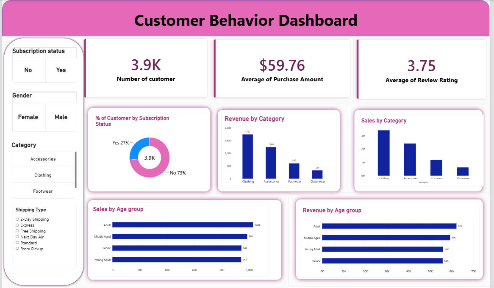

# 📊 Customer Behavior Analysis Dashboard

## 📌 Project Overview

This project focuses on analyzing customer purchasing behavior using Power BI. It provides insights into customer demographics, purchasing patterns, subscription status, sales performance, and revenue distribution.

The interactive dashboard helps understand customer behavior and supports data-driven business decisions.

## 🎯 Project Objectives

- Analyze customer purchasing behavior.
- Understand customer subscription patterns.
- Compare sales and revenue across product categories.
- Analyze purchasing trends across different age groups.
- Explore customer demographics and shipping preferences.
- Identify useful business insights from customer data.

## 🛠️ Tools & Technologies

- Power BI
- Python
- Pandas
- Jupyter Notebook
- Data Visualization
- Data Analysis

## 📈 Key Performance Indicators (KPIs)

- **Total Customers:** 3.9K
- **Average Purchase Amount:** $59.76
- **Average Review Rating:** 3.75

## 📊 Dashboard Highlights

### Visualizations

- Customer Subscription Status
- Revenue by Category
- Sales by Category
- Sales by Age Group
- Revenue by Age Group

### Interactive Filters

- Subscription Status
- Gender
- Category
- Shipping Type

## 🖼️ Dashboard Preview

## 💡 Key Insights

- Clothing represents the highest sales and revenue among the displayed categories.
- Most customers are non-subscribers, indicating an opportunity to improve subscription engagement.
- Adult customers contribute the highest sales among the analyzed age groups.

## 📂 Project Files

| File | Description |
|---|---|
| `customer_shopping_behavior.csv` | Dataset used for analysis |
| `customer_behavior_dashboard.pbix` | Interactive Power BI dashboard |
| `customer_behaviour_dashboard.png` | Dashboard screenshot |

## 🚀 How to Explore the Project

1. Download the dataset from this repository.
2. Open the `.pbix` file using Microsoft Power BI Desktop.
3. Explore the dashboard and interact with the available filters.
4. Review the dashboard insights to understand customer purchasing patterns.

## 💼 Business Value

This analysis helps businesses understand customer purchasing patterns, identify popular product categories, evaluate subscription engagement, and make informed decisions to improve customer experience and sales performance.

## 👩‍💻 Author

**Malka Saeed**

B.Tech CSE Student | Aspiring Data Analyst

---

⭐ If you find this project useful, feel free to explore the repository!
